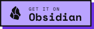

[](https://github.com/DuckTapeKiller/obsidian-reader-highlighter-tags/stargazers)
[](https://github.com/DuckTapeKiller/obsidian-reader-highlighter-tags/issues)
[](https://github.com/DuckTapeKiller/obsidian-reader-highlighter-tags/issues?q=is%3Aissue+is%3Aclosed)
[](https://github.com/DuckTapeKiller/obsidian-reader-highlighter-tags/blob/main/manifest.json)
[](https://github.com/DuckTapeKiller/obsidian-reader-highlighter-tags/releases)


# Reader Highlighter Tags

<a href="https://community.obsidian.md/plugins/reader-highlighter-tags"></a>

**Highlight, colour, tag and annotate your notes without leaving Reading view.** Select a passage, pick a colour, keep reading. Every highlight is plain Markdown, written into the note at the exact spot you selected, in Obsidian's own highlight colours.

<p align="center">
  
</p>

- **Made for reading.** A floating toolbar appears when you select text in Reading view or in a PDF. There's no switching to Edit mode and no hunting for the passage in the source.
- **Plain Markdown, native colours.** Highlights are written as `==text==`, or `==🟡text==` with a colour. The plugin never writes HTML into your notes.
- **Precise.** It finds your selection in the source even through formatting, links, footnotes, lists, tables, callouts and embedded notes, and it keeps list markers and table pipes intact.
- **Organised.** Give each colour a meaning, tag highlights as you go, and add annotations as footnotes. Review a note in the navigator, or every highlight in the vault in the research view.
- **At home in your theme.** The toolbar is built from Obsidian's own menu parts, so every theme and preset styles it like its own menus.
- **Desktop and mobile.**

## Contents

- [Installation](#installation)
- [Highlighting](#highlighting)
- [Colours](#colours)
- [The toolbar](#the-toolbar)
- [Tags](#tags)
- [Annotations](#annotations)
- [Copy as quote](#copy-as-quote)
- [Highlight navigator](#highlight-navigator)
- [Global research view](#global-research-view)
- [Exports](#exports)
- [PDFs](#pdfs)
- [When a selection can't be found](#when-a-selection-cant-be-found)
- [Reading progress](#reading-progress)
- [On mobile](#on-mobile)
- [Commands](#commands)
- [Settings](#settings)
- [Compatibility and privacy](#compatibility-and-privacy)
- [Development](#development)

## Installation

Requires Obsidian **1.7.2** or later. Highlight colours need **1.14** or later.

**From Community plugins.** Open **Settings → Community plugins → Browse**, search for _Reader Highlighter Tags_, then install and enable it.

**With BRAT.** Install [BRAT](https://github.com/TfTHacker/obsidian42-brat), choose _Add beta plugin_, and enter `DuckTapeKiller/obsidian-reader-highlighter-tags`.

**By hand.**

1. Download `main.js`, `manifest.json` and `styles.css` from the [latest release](https://github.com/DuckTapeKiller/obsidian-reader-highlighter-tags/releases/latest).
2. Put them in a folder named `reader-highlighter-tags` inside your vault's `.obsidian/plugins/` folder.
3. Reload Obsidian and enable the plugin under **Settings → Community plugins**.

## Highlighting

Open a note in Reading view and select some text. The toolbar appears next to your selection. Click the highlighter to highlight it, or a colour to highlight it in that colour.

What lands in the note is ordinary Markdown:

```markdown
Our life is frittered away by detail. ==🟢Simplicity, simplicity, simplicity!==
```

The plugin takes care of the details that usually go wrong:

- **Extending and merging.** Select from inside a highlight out past its end and the two become one highlight. A selection that touches several highlights joins them all.
- **Structure stays intact.** List bullets, task boxes, heading marks, quote and callout markers stay outside the highlight. A selection across several paragraphs highlights each paragraph separately.
- **Tables, cell by cell.** Each selected cell gets its own highlight, so the table keeps rendering as a table.
- **The right occurrence.** When the same words appear more than once, the plugin highlights the one you selected.
- **Embedded notes.** Text shown from an embedded note (`![[Note]]`) is highlighted in the note it comes from.
- **Erase.** The trash button removes any highlight your selection touches, across paragraphs too.
- **Undo.** _Undo last highlight_ restores the note as it was before the plugin's last change. If you have edited the note since, it refuses rather than discard your edits.

<p align="center">
  
</p>

## Colours

Obsidian 1.14 gave highlights six colours: red, orange, yellow, green, blue and purple. You write one as an emoji straight after the opening marker, `==🟡text==`, and Reading view shows the colour, never the emoji. This plugin writes exactly that, so your highlights stay plain text that any Markdown editor can read.


- **Meanings.** Give each colour a meaning in the settings, such as _Key idea_, _Question_ or _Vocabulary_. The toolbar shows it when you hover a swatch, and the research view lets you filter by it. You can hide the colours you have not named.
- **A default colour.** By default the highlighter uses your theme's highlight. You can set it to one of the six colours instead.
- **Colours stick.** Extending or tagging a coloured highlight keeps its colour. A colour button recolours it.
- **Recolouring.** Change a single highlight from the navigator, or every highlight of one colour at once with _Recolour highlights in note_.
- **Older notes.** Earlier versions of this plugin wrote colours as HTML (`<mark style="…">`). Those highlights still show up everywhere. _Convert HTML highlights to native highlights in note_ turns them into native ones in the nearest colour, and so does editing or recolouring them.

> [!TIP]
> **For theme authors.** If every highlight colour looks the same in your theme, the theme is probably setting `background-color` on `mark` directly. Set `--highlight-background` instead, or limit your rule to `mark:not([data-highlight])`, and the six colours will show through.

## The toolbar

The toolbar is drawn as one of Obsidian's own menus, with Obsidian's icon buttons. Your theme, and each of its presets, styles it exactly as it styles its context menus, in light and dark mode.


It can sit next to the selection, or stay fixed at the top, bottom, left or right of the window. The left and right positions stack it vertically.


You can switch off the buttons you don't use (tag, quote, annotate and erase) and turn tooltips on or off. Colour swatches always show their meaning on hover. The toolbar never appears for text in code blocks, in dialogs or outside the note.

## Tags

The tag button highlights the selection and puts tags in front of it: `#simplicity ==🟢Simplicity, simplicity, simplicity!==`. The dialog suggests the tags you used most recently and those of the note's folder and properties, and searches every tag in your vault. You can pick several tags, or create a new one by typing it.

<p align="center">
  
</p>

- **Default tag prefix.** Add the same tag to every highlight, for example `#book`.
- **Frontmatter tag.** Optionally add a tag such as `resaltados` to the note's `tags` property whenever you highlight, so highlighted notes are easy to find.

## Annotations

The annotate button attaches a comment to the selection. It is stored as a standard Markdown footnote: a numbered reference after the passage and the comment at the end of the note. Any Markdown app can read it, and you can review it in the navigator.

<p align="center">
  
</p>

## Copy as quote

The quote button copies the selection as a blockquote, filled in from a template you can edit. The default template credits the note:

```markdown
> {{text}}
>
> — [[{{file}}]]
```

| Variable     | Becomes                                                                                                                   |
| ------------ | ------------------------------------------------------------------------------------------------------------------------- |
| `{{text}}`   | The selected text. Every line takes whatever precedes `{{text}}` on its line, so a multi-line quote stays one blockquote. |
| `{{file}}`   | The note's name                                                                                                           |
| `{{path}}`   | The note's path in the vault                                                                                              |
| `{{date}}`   | Today's date, `2026-10-17`                                                                                                |
| `{{time}}`   | The current time, with its UTC offset                                                                                     |
| `{{author}}` | The note's `author`, `authors` or `creator` property                                                                      |
| `{{domain}}` | The site of the note's `url`, `source` or `link` property                                                                 |

<p align="center">
  
</p>

## Highlight navigator

The navigator lists every highlight and footnote in the current note, in a sidebar that follows you from note to note. Each highlight shows its colour. Click one to jump to it, or search the list.


Switch between **Highlights**, **Footnotes** and **Both**. The **⋯** button on a highlight lets you copy it, edit it, remove it, or remove every highlight in the note. **Bulk** merges neighbouring highlights of the same colour, recolours the note, and converts old HTML highlights.

<p align="center">
  
  &nbsp;&nbsp;
  
</p>

**Edit** opens one highlight in a dialog: change its colour, its tags, or its annotation, or remove it. **Recolour** changes every highlight of one colour at once.

<p align="center">
  
  &nbsp;&nbsp;
  
</p>

## Global research view

The research view gathers every highlight in your vault in one list. Search their text, filter by any property in your notes' frontmatter, and toggle the colours you have given meanings. Click a highlight to open the note at that spot.


**Export canvas** lays out whatever you have filtered as an Obsidian Canvas: one column per note, its highlights below it, each card in its highlight's colour.


## Exports

From the navigator, or with a command:

- **Markdown.** _Export highlights to new note_ writes a note of live embeds (`![[Note#^id]]`). It adds a block ID to each line that holds a highlight, so the export always shows the current text, edits included. A table gets one block ID on the line after it, where Obsidian expects it.
- **JSON** and **CSV.** Each highlight with its text, colour, tags, annotation, line and block embed, ready for other tools. Right-click the navigator's **Export md** button to choose the format.
- **Canvas.** The current note from the navigator, or a filtered set from the research view.


## PDFs

The toolbar works in Obsidian's PDF viewer too. Highlights from a PDF are saved to a companion note next to it, `Book - Highlights.md`, as quotes that link back to the PDF. Colours carry over. On a PDF the toolbar adds **Extract all text**, which copies the whole PDF's text into the companion note.


## When a selection can't be found

Occasionally what Reading view shows differs too much from the source for the passage to be found, for example with unusual markup. Instead of guessing, the plugin shows you its best match and lets you correct it. **Apply once** highlights your corrected text. **Apply & learn** also remembers the stray characters it had to ignore, so the same kind of selection works next time. You can review and delete learned rules in the settings.

<p align="center">
  
</p>

## Reading progress

The plugin remembers how far you have read in each note, saving your place whenever you stop scrolling. Run _Resume reading_ to jump back there. You can clear the saved positions in the settings.

## On mobile

Everything works on phones and tablets. The buttons grow to touch size, and on a phone the colours wrap onto a second row when the bar would be wider than the screen. On iOS, a long press on a selection highlights it straight away. On Android the toolbar sits below the selection, clear of the system's copy menu. Successful actions give a light vibration, which you can turn off. A ribbon button highlights the current selection.

<p align="center">
  
</p>

## Commands

Every action is a command, so you can give it a hotkey in **Settings → Hotkeys**. None are bound by default.


| Command                                                       | What it does                                                   |
| ------------------------------------------------------------- | -------------------------------------------------------------- |
| Highlight selection                                           | Highlights the selection, in the default colour if you set one |
| Apply red / orange / yellow / green / blue / purple highlight | Highlights the selection in that colour                        |
| Tag selection                                                 | Highlights the selection and tags it                           |
| Add annotation to selection                                   | Adds a footnote comment after the selection                    |
| Copy selection as quote                                       | Copies the selection using your quote template                 |
| Remove highlight from selection                               | Removes every highlight the selection touches                  |
| Undo last highlight                                           | Restores the note as it was before the plugin's last change    |
| Remove all highlights from note                               | Removes every highlight in the note, keeping the text          |
| Remove all annotations from note                              | Removes every footnote annotation in the note                  |
| Merge adjacent highlights in note                             | Joins neighbouring highlights of the same colour               |
| Recolour highlights in note                                   | Changes every highlight of one colour to another               |
| Convert HTML highlights to native highlights in note          | Turns old `<mark>` and `<span>` highlights into native ones    |
| Export highlights to new note / to JSON / to CSV              | Exports the note's highlights                                  |
| Open highlight navigator                                      | Opens the navigator in the sidebar                             |
| Open global research view                                     | Opens the research view                                        |
| Extract all text from current PDF                             | Copies a PDF's text into its companion note                    |
| Resume reading                                                | Jumps to where you stopped reading                             |

## Settings


| Setting                                    | Default          | What it does                                                           |
| ------------------------------------------ | ---------------- | ---------------------------------------------------------------------- |
| Toolbar position                           | Fixed right side | Next to the text, or fixed at the top, bottom, left or right           |
| Highlight colour                           | Theme default    | The colour the highlighter writes                                      |
| Show colour palette                        | Off              | Shows the six colours in the toolbar                                   |
| Only show colours with a meaning           | On               | Hides colours you haven't named; shows all six until you name one      |
| Colour meanings                            | None             | A name for each colour, shown on hover and used as research filters    |
| Default tag prefix                         | None             | A tag added in front of every highlight                                |
| Smart tag suggestions                      | On               | Suggests recent tags and tags from the note's folder and frontmatter   |
| Smart paragraph selection                  | Off              | Widens a selection to its whole paragraph, list item, heading or quote |
| Quote format                               | `> {{text}}` …   | The template used by _Copy as quote_                                   |
| Enable annotations, Show annotation button | On               | Annotations and their toolbar button                                   |
| Track reading progress                     | On               | Remembers your place in each note                                      |
| Show tag, quote and remove buttons         | On               | Which buttons the toolbar shows                                        |
| Haptic feedback                            | On               | A light vibration on success, on mobile                                |
| Show button tooltips                       | Off              | Tooltips on the toolbar's action buttons                               |
| Auto-tag highlight in frontmatter          | Off              | Adds a tag to the note's `tags` property when you highlight            |
| Learned normalization rules                | None             | Rules saved by _Apply & learn_, each one removable                     |

## Compatibility and privacy

- Works with Obsidian 1.7.2 and later, on desktop and mobile. Highlight colours need Obsidian 1.14 or later; older versions show the colour emoji in front of the text.
- Everything happens inside your vault. The plugin makes no network requests and collects nothing.
- Your notes stay plain Markdown. Uninstall the plugin and every highlight, tag, annotation and quote is still there, readable by anything.

## Development

```bash
npm install
npm run build
npm test
```

`npm run build` lints first, twice: with the project's ESLint config, and with only `eslint-plugin-obsidianmd`'s recommended rules, the community review bot's view. Both must finish with no errors and no warnings. CI runs the same checks with the latest Obsidian rules on every push and pull request, and once a week.

## Licence

[MIT](LICENSE)
